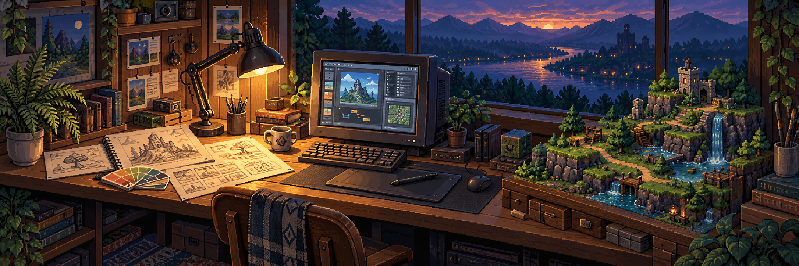

# Oi, eu sou o Igor Henrique.

**Design, código e jogos dividem a mesma bancada por aqui.**

Este é meu laboratório criativo: um lugar para explorar ideias, desenhar interfaces, mexer em mods e construir outras implementações. Gosto do caminho entre imaginar alguma coisa e descobrir como fazê-la funcionar.

### Um pouco do que está aberto

**[Daily Luck & Dish Predictions — Stardew Valley](https://github.com/igorhrmoraes/StepsTakenRNGPrediction)**  
Atualização de um mod de previsão de sorte e pratos para Stardew Valley 1.6, com correções na simulação de RNG e integração com o Generic Mod Config Menu. Um encontro entre curiosidade sobre o jogo, código e cuidado com a interface.

Fork do trabalho de BlaDe e Versy024; minha contribuição está na atualização de compatibilidade e no menu de configuração.

**[Stardew Seed Finder](https://github.com/igorhrmoraes/stardewseedfinder)**  
O começo de um projeto para explorar seeds de Stardew Valley. Por enquanto, o repositório está em fase inicial.

<b>O que cabe nesse laboratório?</b>

- **Design:** composição, identidade visual e interfaces.
- **Código:** ferramentas, experimentos e ideias que ganham forma.
- **Jogos:** mods, sistemas e curiosidade sobre como os mundos funcionam.

Nem todo experimento vira um produto. Alguns viram aprendizado para o próximo.

[Explorar os repositórios públicos →](https://github.com/igorhrmoraes?tab=repositories&type=public)
