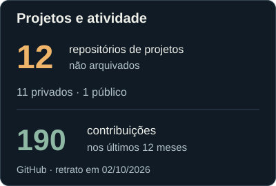
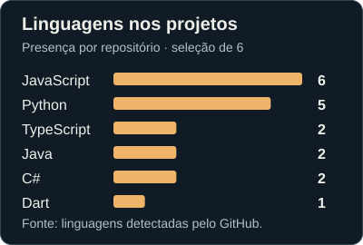

# Oi, eu sou o Igor Henrique.

**Design, código e jogos dividem a mesma bancada por aqui.**

Crio interfaces, sites, sistemas e ferramentas — e também gosto de explorar o que acontece por trás dos jogos. Meu trabalho conecta composição visual, desenvolvimento web e mobile, dados e modding. A parte que mais me interessa é dar forma a uma ideia e fazer cada peça funcionar junto.

Este GitHub é meu laboratório criativo: reúne aplicações, experimentos e implementações em diferentes estágios. Boa parte desse trabalho vive em repositórios privados; abaixo está um panorama das tecnologias e do que construo.

## Linguagens e ferramentas

  
  
  
  
  
  

**TypeScript · JavaScript · Python · Java · C# · Dart**

Também uso **HTML, CSS e PowerShell** para estruturar interfaces, cuidar da apresentação e automatizar tarefas.

| Onde aplico | Tecnologias e ferramentas |
| :--- | :--- |
| **Web e interfaces** | React, Next.js, Vite, Tailwind CSS |
| **Aplicações mobile** | Flutter e Dart |
| **Serviços e dados** | Node.js, Express, PostgreSQL, SQLite, Drizzle ORM |
| **Mapas e visualização** | D3 Geo, Recharts e Python |
| **Mods e jogos** | Java / Fabric · C# / .NET / SMAPI |
| **Design e desenvolvimento** | Figma, Git e GitHub · Playwright e Vitest |

## O laboratório em números

  
  

<!-- STATS:START -->
Dados de 02/10/2026. Repositórios próprios não arquivados, incluindo forks e excluindo este perfil.

Resumo acessível e como os números são contados

- **12 repositórios de projetos:** 11 privados e 1 público; 1 fork incluído.
- **190 contribuições** registradas pelo GitHub de 02/10/2025 a 02/10/2026, incluindo o total agregado de atividade privada. Contribuições não são sinônimo de commits.
- **Presença das linguagens:** JavaScript: 6; Python: 5; TypeScript: 2; Java: 2; C#: 2; Dart: 1 repositório(s).

O gráfico conta em quantos repositórios cada linguagem selecionada aparece. Um projeto pode usar várias linguagens. Ele não mede proficiência, autoria de cada linha ou proporção de código, e não é uma lista de todas as linguagens detectadas pelo GitHub.

Os números são um retrato da data indicada, sem atualização automática. Nenhum nome ou conteúdo de projeto privado é exposto. [Dados agregados](data/summary.json) · [Rotina de atualização](scripts/update-profile-stats.py).

<!-- STATS:END -->

## O que construo

- **Design e experiências digitais.** Identidades visuais, sites e interfaces, conectando composição, navegação e implementação.
- **Aplicações e sistemas.** Ferramentas de organização, aplicações mobile e sistemas de gestão, com interfaces, serviços e persistência de dados.
- **Dados que podem ser explorados.** Mapas interativos e dashboards para organizar informação e tornar consultas mais claras.
- **Jogos e modding.** Geração de mundos, adaptações de mods, ferramentas de apoio e investigação dos sistemas que fazem um jogo funcionar.

## Um trabalho que está aberto

### [Daily Luck & Dish Predictions — Stardew Valley](https://github.com/igorhrmoraes/StepsTakenRNGPrediction)

Um mod para prever sorte diária e pratos em Stardew Valley. Minha contribuição está na atualização para a versão **1.6**, em correções na simulação de **RNG** e na integração com o **Generic Mod Config Menu**, facilitando a configuração dentro do jogo.

**C# · .NET · SMAPI · GMCM**

Fork do trabalho de BlaDe e Versy024, com créditos e detalhes técnicos no repositório.

[Ver o projeto →](https://github.com/igorhrmoraes/StepsTakenRNGPrediction) · [Explorar os repositórios públicos →](https://github.com/igorhrmoraes?tab=repositories&type=public)

Ícones: [Skill Icons](https://github.com/tandpfun/skill-icons), sob [licença MIT](assets/icons/LICENSE).
